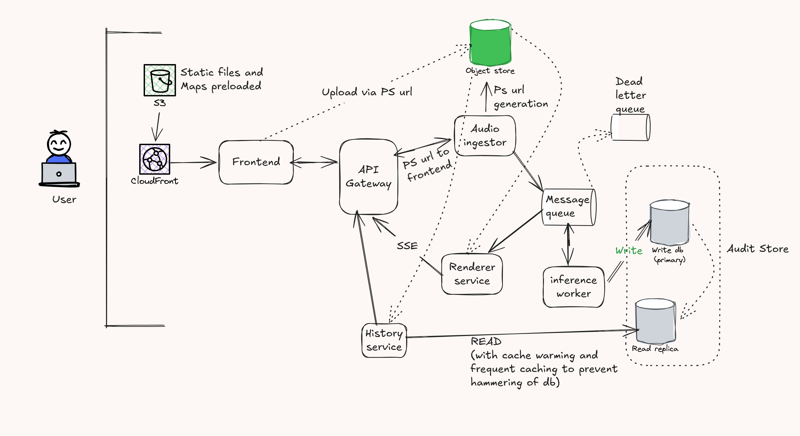

# railRant
A platform where you can rant about trains being late and other IR problems in your favorite language, and join million others (sorry, this broke dev doesn't have enough infra to handle millions, but you can understand the sarcasm), and let the railway officials know everything, without becoming a keyboard warrior or account tag master on twitter.
## Note
*DONE WHILE SITTING IN AN ACTUAL TRAIN
Idea is mine, architecture is mine, implementation is done by AI (yk, time constraints and laziness)
## Architecture

## Tech stack
1. Golang (net/http) for audio ingestor, history service
2. FastAPI for renderer service (easy to implement LOL)
3. Python worker (with gnan AI stuff) for inference worker
4. PostgreSQL (through neon) for database
5. Redis cloud for cache
6. NextJS for frontend (and some random js libs for maps and stuff, pls ask gemini, i am not a frontend dev)
7. Amazon S3 for object store
8. Amazon SQS for message queue

